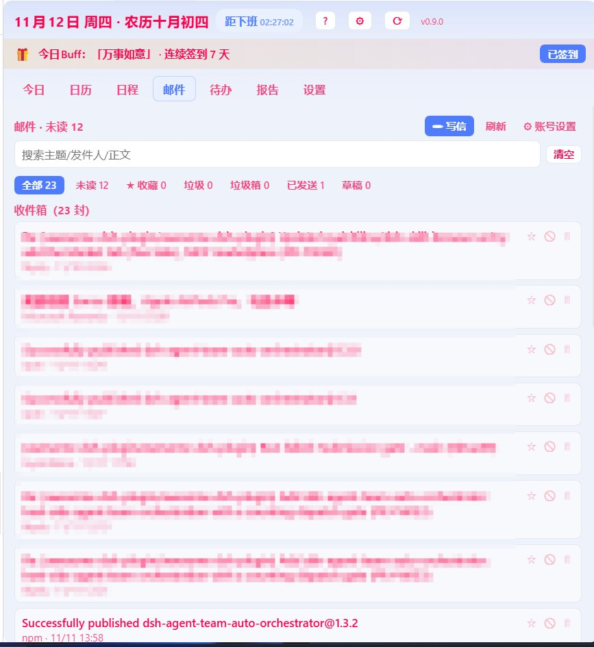
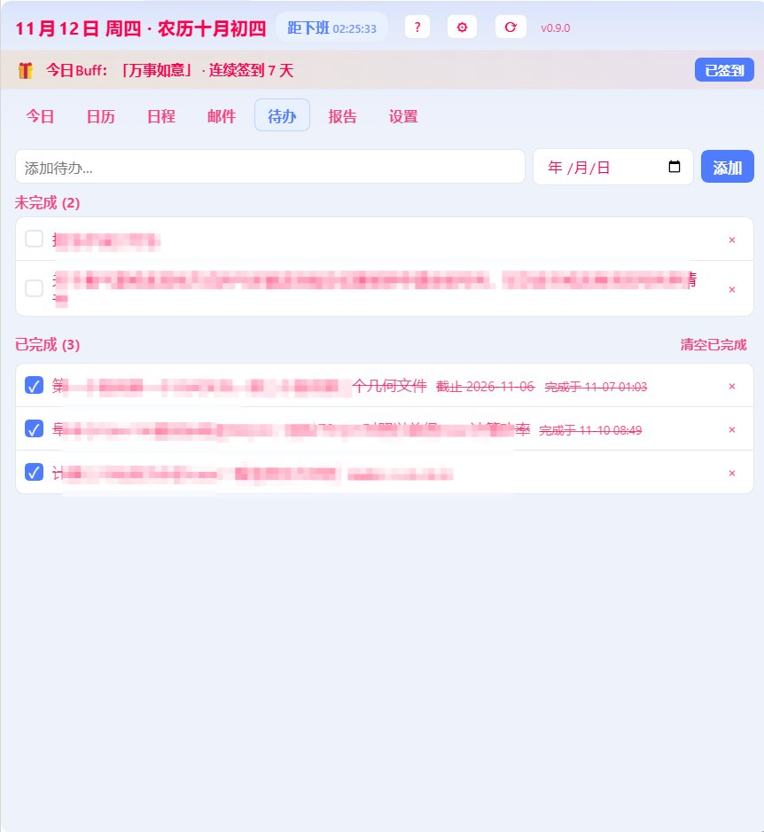

# dsh-schedule-calendar · 日程助手

> **功能描述**：日程助手一个面板搞定：今日一屏（城市天气定点刷新 + 黄历 + 可折叠星座运势）、农历月历与日程待办、日报周报与每日签到，外加多账号 IMAP 收信 / SMTP 发信的邮件客户端（附件收发、草稿箱、群发）、久坐 / 喝水 / 护眼 / 听音乐提醒（界面内浮层胶囊 + 可选 Windows 系统通知，停留秒数与弹出位置可调，可手动预览）与壁纸轮播外观。适配 DSH 内核 0.2.2-rc.1。
>
> **English**: Schedule assistant in one panel: a today view with city weather refreshed at fixed times, an almanac and a collapsible horoscope block, a lunar month calendar, events and to-dos, daily and weekly reports and a daily check-in — plus a multi-account mail client (IMAP receive + SMTP send, attachments in both directions, drafts, group send), health reminders that surface as an in-app floating capsule on top of the DSH client (adjustable dwell time of 3–60 s and position, optional Windows system notification, manual preview), and a rotating wallpaper appearance. Adapts DSH kernel 0.2.2-rc.1.

DSH 桌面端的侧边栏「日程助手」插件：城市天气（定点刷新）、黄历宜忌、农历月历、日程与提醒、工作待办、日报周报、星座运势与配对、好运签到、按人设置的休息日（双休 / 大小周 / 单休 / 自定义）与上下班倒计时，还能收发邮件（多账号 IMAP / SMTP）、按点弹健康提醒、轮播壁纸做背景 —— 全部收进一个侧边栏标签页。

> 依赖宿主插件 `dsh-better-sidebar`（提供侧边栏标签页能力，未安装则标签页挂不上），并需要 DSH 0.2.2+。

## 效果图

| 今日（天气 / 日程 / 星座） | 日历（农历 / 假期 / 班休） |
| --- | --- |
|  |  |

| 邮件（多账号收件箱） | 待办（未完成 / 已完成） |
| --- | --- |
|  |  |

| 设置 · 外观（文字颜色 / 壁纸轮播） |
| --- |
|  |

## 功能

- **城市天气（定点刷新）**：按「省 / 市 / 区」级联或关键字搜索添加城市（区级用 Nominatim 地理编码，回退 Open-Meteo），横向表格显示今天 / 明天 / 后天 / 大后天 4 天预报；每天 **8:30 / 12:00 / 17:30** 定点刷新，其余时间保持静态不跳动，也可手动「🔄 刷新」，失败自动重试。
- **黄历（宜 / 忌）**：今日头部在星期右侧显示农历与当日宜忌（本地黄历算法，按日固定），可在设置里开关。
- **农历月历**：月视图显示农历与节气、法定节假日；周末 / 个人休息日 / 法定假期 / 补班上班 四类背景色可区分，且可在设置里自定义颜色；**点击某天即可查看 / 添加当天日程**（也支持右键加日程）；**开背景图时格子自动半透明**以免挡住壁纸，不开背景则保持原配色。
- **日程**：增删改，字段含标题、日期、时间、备注、提前提醒；重复支持**不重复 / 每日 / 每周 / 每月 / 每年 / 农历每年（生日纪念）**；记录创建时间；列表按下次发生排序，**本周期已过发灰、未到的高亮**。
- **工作待办**：增删改与完成状态切换，可设**截止日期**，未完成按截止日排序、逾期红色「⚠ 逾期」，已完成显示完成时间。
- **日报 / 周报**：日报可「一键生成（自动统计当日日程 / 未完成任务 / 已完成）」，支持按日期区间**批量一键生成**；周报自动汇总本周日报与完成情况，也可手动修改并保存。
- **星座运势（可开关）**：在「设置」里为每人填写生日（可选**阳历 / 农历 + 年份**，自动识别星座）；「今日」底部显示星座图案与每日气运（综合 / 恋爱 / 事业 / 财运 / 幸运色 / 幸运数字），并给出**星座配对**（最配 TOP3 + 与其余 11 星座的相处评分）；整块可在设置里开关，并已做**紧凑折叠**，展开才占版面。
- **好运签到**：今日顶部 Buff 条，每日签到随机抽取「鸿运当头 / 日进斗金 / 暴富」等好运词并附健康提醒，连续签到累计天数。
- **人员与班制**：多人管理；每人在「双休 / 大小周 / 单休 / 自定义星期」间切换。**大小周**语义：大周周六周日都休（双休），小周周六上班、周日休；可指定本周大 / 小周并自动交替。
- **上下班倒计时**：按当前人员班制实时倒计时（距上班 / 距下班），上下班到点提醒。
- **左侧栏入口**：在原生左侧栏脚部注入「日程助手」按钮，一键打开右侧面板；也可从右侧「新建标签页」选择「日程助手」。
- **外观（壁纸文件夹轮播）**：设置里可填一个壁纸文件夹路径（jpg / png / webp / gif），插件读取文件夹内图片自动轮播为面板背景；支持**顺序 / 随机不重复洗牌**两种播放方式、切换间隔、透明度、磨砂玻璃开关，**文字颜色可设为自动 / 深色字 / 浅色字 / 自定义取色**，深浅色自动适配；开背景图时日历格子自动半透明。
- **健康 / 趣味提醒**：久坐、喝水（科学饮水量按体重估算）、摸鱼 / 护眼、听音乐四条内置提醒，可改间隔与时段、可增删、可恢复默认。**到点由宿主端扫描**（不依赖界面是否打开）：在 DSH 客户端界面**最上层浮出自绘的胶囊卡片**（`document.body` 固定层，z-index 10500，**与侧边栏是否展开无关**），**停留时间可在设置里设 3~60 秒（默认 6 秒）**，**弹出位置用左右 / 上下两个百分比滑块调**，**点一下胶囊立即关闭**；也可**同时推送 Windows 系统通知**（独立开关，窗口最小化也能看到），还可选择自动弹出侧边栏定位到日程助手，各开关可单独关闭；设置里每条提醒都有 **▶ 手动预览**（只预览效果，不消耗正式计时）。
- **邮件（IMAP 收信 + SMTP 发信，QQ 邮箱实测通过）**：**多账号**，每个账号独立授权码、存本机凭据库，按账号设定的间隔定时收信。收件箱 **七个页签**（全部 / 未读 / 星标 / 垃圾 / 垃圾箱 / 已发送 / 草稿），**未读与已读底色区分**，支持关键词搜索、点开看全文（自动标已读）、收藏（星标）/ 标记垃圾 / 删除（本地 + IMAP 双向尽力同步）/ 还原；正文里的网址显示为蓝色可点，**用系统默认浏览器打开**。写信支持**多附件（含中文文件名）**与群发（逐封限速），带**草稿箱**；**附件收发都支持** —— 收信附件落盘后可预览、「↗ 用系统默认应用打开」（发信仅纯文本正文，不支持 HTML 排版）。账号信息卡显示服务器 / 检查间隔 / 上次检查 / 未读统计。
- **日程生日上锁与解锁**：日历视图的生日纪念可上锁保护隐私，解锁后显示备注内容；支持自动排列。
- **设置分栏**：设置页按 班制 / 城市 / 提醒 / 外观 / 数据 / 关于 六个二级分栏，不挤在一页。
- **数据随包走**：全部数据为本地 JSON（插件包内 `data/store.json`），不上传云端，便于整包打包 / 备份。

## 已知限制

- 邮件正文只渲染**纯文本化内容**，不支持 HTML 正文渲染；发信也只发纯文本正文，不带 HTML 排版。
- 「已发送」只存本地副本，不会同步写入邮箱服务器的「已发送」文件夹。
- 附件单封上限 **8MB**、单次合计上限 **20MB**。
- 提醒有**两条独立通路**：**界面内浮层胶囊**（自绘在 DSH 客户端界面之上，与侧边栏展开与否无关）与 **Windows 系统通知**，可分别开关。界面胶囊属客户端侧改动，改完按 **Ctrl+Shift+R 硬刷新**即生效，**不需要重启宿主 / DSH 客户端**；只有宿主端扫描逻辑（`lib/index.js`）变更才需要彻底退出再启动。

## 安装（桌面端 · desktop profile）

> 桌面端 profile 由 Electron 独占，`dsh plugin --profile desktop` 会被拒绝，需手改 profile。

1. 把本包放到 `~/.dsh/local-plugins/dsh-schedule-calendar`（或 `npm i dsh-schedule-calendar`）。
2. 编辑 `~/.dsh/profiles/desktop/package.json`：
   - `dependencies` 增加：`"dsh-schedule-calendar": "link:<本包绝对路径>"`（npm 安装则写版本号）
   - `dsh.profile.bundles` 增加：`"dsh-schedule-calendar"`
3. 在该 profile 目录执行 `pnpm install`。
4. **完全退出 DSH 再启动**（宿主端无热重载）。左侧栏脚部出现「日程助手」按钮，点击打开右侧面板。

## 数据与隐私

- 数据只写本机插件包内 `data/store.json`，不上传任何服务器。
- 天气 / 城市 / 节假日 / 黄历 / 星座运势由宿主端代理转发或本地生成；失败时界面降级提示，不影响日程与待办。

## 开发

- 宿主端：`lib/index.js`（`ctx.webServer.register` 前缀路由：`/ping` `/data` `/geocode` `/weather` `/holidays` `/lunar` `/divisions` `/resolve` `/almanac` `/horoscope` `/lunar2solar`）。
- 客户端：`lib/client.js`（`__ModuleLoader__.load` 手写 bundle，`ctx.betterSidebar.registerTab` + 左侧栏槽位）。
- 契约：`dsh.bundle.patch` + `dsh.client.platform: web`；bundle id / package name / patch name 三处一致。
- 本地探针：`scripts/probe.cjs`（迷你 React 运行时渲染七视图）、`scripts/probe-host.mjs`（假 req/res 跑宿主全路由）。

MIT License.
