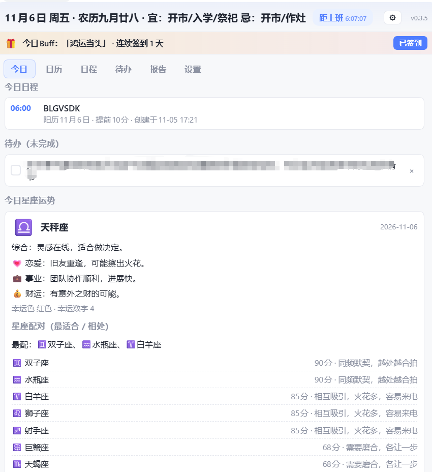
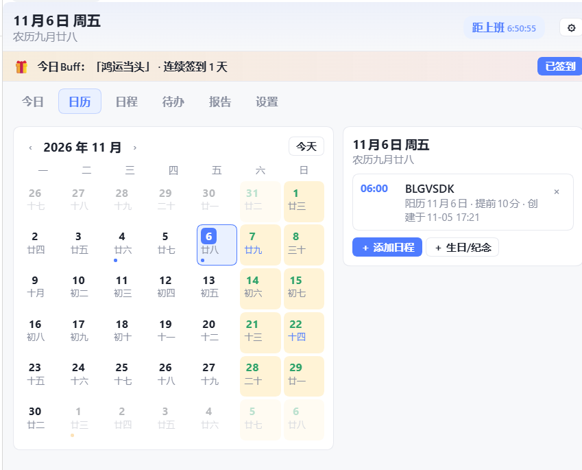
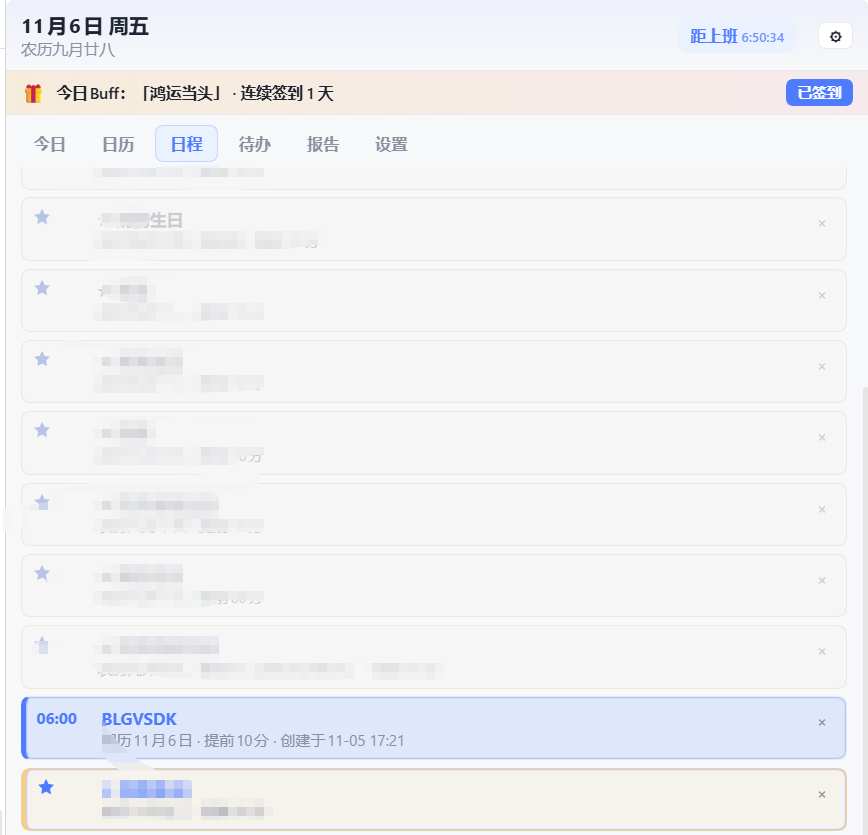
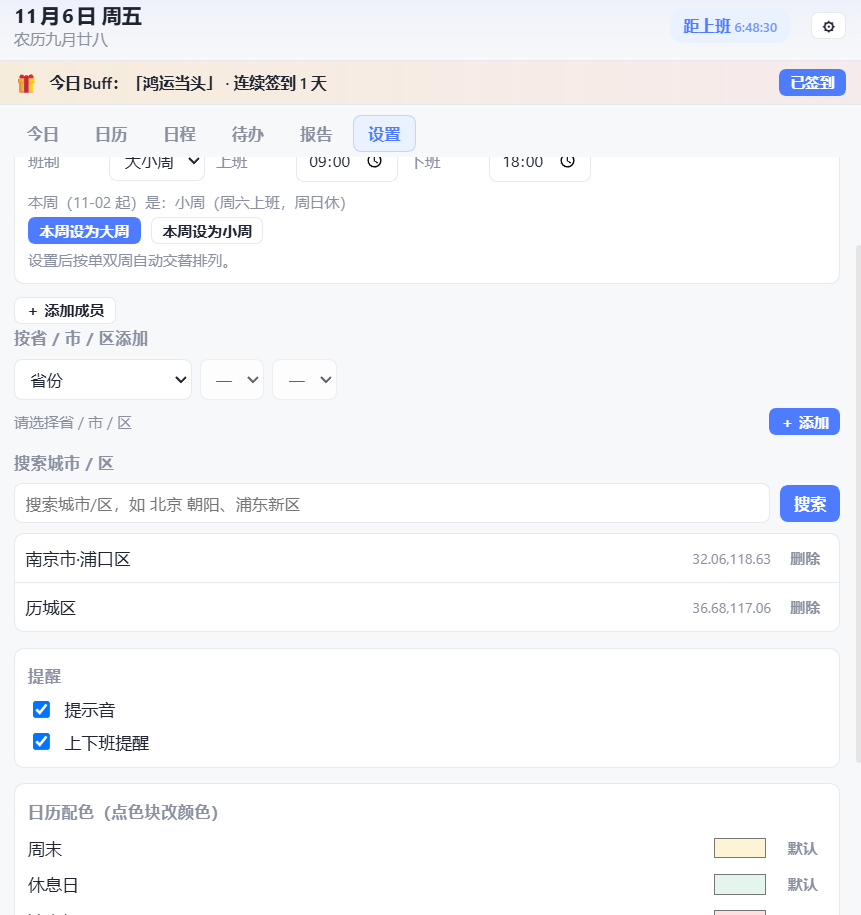

# dsh-schedule-calendar · 日程助手

DSH 桌面端的侧边栏「日程助手」插件：多城市天气、黄历宜忌、农历日历、日程与提醒、工作待办、日报周报、星座运势与配对、好运签到，以及按人设置的休息日（双休 / 大小周 / 单休 / 自定义）与上下班倒计时，全部收进一个侧边栏标签页。

> 依赖宿主插件 `dsh-better-sidebar`（提供侧边栏标签页能力）。

## 效果图

| 今日（天气 + 日程 + 星座运势） | 日历（农历 / 假期 / 休息日配色） |
| --- | --- |
|  |  |

| 日程（重复 / 未来高亮） | 待办（截止日期 / 逾期） |
| --- | --- |
|  |  |

| 报告（日报 / 周报 / 批量） | 设置（人员班制 / 城市 / 配色 / 关于） |
| --- | --- |
|  |  |

## 功能

- **多城市天气**：按「省 / 市 / 区」级联或关键字搜索添加城市（区级用 Nominatim 地理编码，回退 Open-Meteo），横向表格显示今天 / 明天 / 后天 / 大后天 4 天预报；支持「🔄 刷新」与失败自动重试。
- **黄历（宜 / 忌）**：今日头部在星期右侧显示农历与当日宜忌（本地黄历算法，按日固定）。
- **农历日历**：显示农历与节气、法定节假日；周末 / 个人休息日 / 法定假期 / 补班上班 四类背景色可区分，且可在设置里自定义颜色；日历右侧分栏点日期看/加当天日程，支持右键加日程。
- **日程**：标题、日期、时间、备注、提前提醒；支持**不重复 / 每日 / 每周 / 每月 / 每年 / 农历每年（生日纪念）**；记录创建时间；列表按下次发生排序，**本周期已过发灰、未到的高亮**。
- **工作待办**：可设**截止日期**，未完成按截止日排序、逾期红色「⚠ 逾期」，已完成显示完成时间。
- **日报 / 周报**：日报可「一键生成（自动统计当日日程 / 未完成任务 / 已完成）」，支持按日期区间**批量一键生成**；周报自动汇总本周日报与完成情况，也可手动修改并保存。
- **星座运势**：在「设置」里为每人填写生日（可选**阳历 / 农历 + 年份**，自动识别星座）；「今日」底部显示星座图案与每日气运（综合 / 恋爱 / 事业 / 财运 / 幸运色 / 幸运数字），并给出**星座配对**（最配 TOP3 + 与其余 11 星座的相处评分）。
- **好运签到**：今日顶部 Buff 条，每日签到随机抽取「鸿运当头 / 日进斗金 / 暴富」等好运词并附健康提醒，连续签到累计天数。
- **人员与班制**：多人管理；每人在「双休 / 大小周 / 单休 / 自定义星期」间切换。**大小周**语义：大周周六周日都休（双休），小周周六上班、周日休；可指定本周大 / 小周并自动交替。
- **上下班倒计时**：按当前人员班制实时倒计时（距上班 / 距下班），上下班到点提醒。
- **左侧栏入口**：在原生左侧栏脚部注入「日程助手」按钮，一键打开右侧面板；也可从右侧「新建标签页」选择「日程助手」。
- **数据随包走**：数据存在插件包内 `data/store.json`，便于整包打包 / 备份。

## 安装（桌面端 · desktop profile）

> 桌面端 profile 由 Electron 独占，`dsh plugin --profile desktop` 会被拒绝，需手改 profile。

1. 把本包放到 `~/.dsh/local-plugins/dsh-schedule-calendar`（或 `npm i dsh-schedule-calendar`）。
2. 编辑 `~/.dsh/profiles/desktop/package.json`：
   - `dependencies` 增加：`"dsh-schedule-calendar": "link:<本包绝对路径>"`（npm 安装则写版本号）
   - `dsh.profile.bundles` 增加：`"dsh-schedule-calendar"`
3. 在该 profile 目录执行 `pnpm install`。
4. **完全退出 DSH 再启动**（宿主端无热重载）。左侧栏脚部出现「日程助手」按钮，点击打开右侧面板。

## 数据与隐私

- 数据只写本机插件包内 `data/store.json`，不上传任何服务器。
- 天气 / 城市 / 节假日 / 黄历 / 星座运势由宿主端代理转发或本地生成；失败时界面降级提示，不影响日程与待办。

## 开发

- 宿主端：`lib/index.js`（`ctx.webServer.register` 前缀路由：`/ping` `/data` `/geocode` `/weather` `/holidays` `/lunar` `/divisions` `/resolve` `/almanac` `/horoscope` `/lunar2solar`）。
- 客户端：`lib/client.js`（`__ModuleLoader__.load` 手写 bundle，`ctx.betterSidebar.registerTab` + 左侧栏槽位）。
- 契约：`dsh.bundle.patch` + `dsh.client.platform: web`；bundle id / package name / patch name 三处一致。
- 本地探针：`scripts/probe.cjs`（迷你 React 运行时渲染七视图）、`scripts/probe-host.mjs`（假 req/res 跑宿主全路由）。

MIT License.
